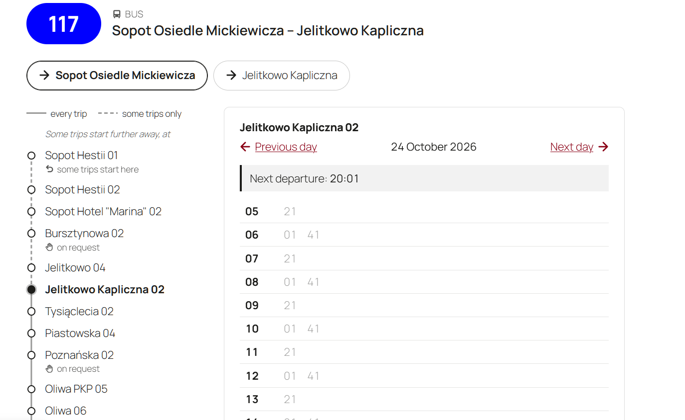

# PTD GTFS Schedules

A WordPress plugin that turns the GTFS feed of a transport operator or authority into public transport timetables on its website: lists of lines, line pages with route diagrams, stop timetables and departure boards from static data feed.

Import the feed once, add a block to a page, and the timetables stay current as the feed is updated.



## What it shows

- **Lines**: every line of the network, grouped by transport mode (trams, buses, night lines and so on), optionally in tabs. Each line links to its own page.
- **Line pages**: the directions of a line, a diagram of its route with the stops and the variants some trips take (detours, short workings, trips starting or ending elsewhere), and the timetable of the chosen stop. Departures that have left are greyed out and the next one is highlighted.
- **Stop timetables**: all departures from a stop on a given day, for every line or for one.
- **Departure boards**: the next departures from a stop, updating themselves while the page is open.
- **Trips**: every departure time opens its trip, from the first stop to the last, with the time at every stop. The rider's stop is highlighted, and the stops the trip has passed are greyed out.

### For riders

- **The next departure at a glance**: departures that have left are greyed out and the next one is highlighted, and both move on as time passes.
- **No surprises about where a trip goes**: trips that end early or take another way are marked with a letter, explained under the timetable: "a – to City Stadium A".
- **Only the stops they can use**: stops where nobody can get on or off are left out, and riders see where to signal the driver (stops on request) and where they can only get on or only get off.
- **A clear picture of the route**: the diagram shows where branches leave the route, where they come back and where some trips end.
- **For everyone**: every icon and diagram has a text equivalent for screen readers, and the pages work without JavaScript.
- **Language support**: English, Ukrainian and Polish.

### For editors and admins

- Blocks for the block editor and shortcodes for any page.
- Import from the feed's address or from an uploaded .zip file, then update it automatically every night or week.
- Imports run in short steps with progress shown, so large feeds work on shared hosting too. Visitors keep seeing the old shedule until the new one is fully imported.
- A stop finder in the admin gives ready-to-paste shortcodes.
- A WP-CLI command for imports from the server.

## Requirements

- WordPress 6.5 or later
- PHP 8.1 or later

## Installation

1. Download `ptd-gtfs-schedules.zip` from the latest [release](https://github.com/publictransitdata/WP-GTFS-schedules/releases/latest).
2. In WordPress, go to **Plugins → Add New Plugin → Upload Plugin**, choose the file and install it.
3. Activate the plugin.

Use the .zip attached to the release, not GitHub's "Source code" archive: the release .zip has the plugin in a `ptd-gtfs-schedules` folder, as WordPress expects.

## Getting started

1. Open **GTFS Schedules** in the admin menu. Enter the address of your GTFS feed, or upload its .zip file, and import it.
2. Add the **Lines** block to a page, for example the home page.
3. Create one page with the **Line timetable** block. Every Lines block on the site links to it.
4. To show a single stop, look it up under **Find a stop** and paste its shortcode into any page.

### Shortcodes

| Shortcode | Shows |
| --- | --- |
| `[ptd_gtfs_lines]` | The list of lines. Options: `modes="tram,bus"`, `layout="destinations"`, `tabs="yes"`, `night="mixed"`, `heading="3"`. |
| `[ptd_gtfs_line]` | The line page. Put it, or the Line timetable block, on one page: every list of lines links there. |
| `[ptd_gtfs_timetable stop="123"]` | The timetable of a stop; add `route="7"` for one line only. |
| `[ptd_gtfs_departures stop="123" limit="8"]` | The next departures from a stop. |

### WP-CLI

```bash
wp ptd-gtfs-schedules import                      # from the feed URL in the settings
wp ptd-gtfs-schedules import --file=feed.zip      # from a file on the server
wp ptd-gtfs-schedules import --force              # even if the feed has not changed
```

Automatic updates run at night through WP-Cron. On sites with little traffic, set up a real cron job for `wp-cron.php`, or run the import from the server's cron. Automatic updates import from the feed URL and replace data imported from an uploaded file.

## Supported GTFS

The plugin reads `agency.txt`, `stops.txt`, `routes.txt`, `trips.txt`, `stop_times.txt`, `calendar.txt` and `calendar_dates.txt`, including extended route types, times after midnight, arrival times where a vehicle waits at a stop, and stations with several platforms.

## Customising

- **Styles**: the markup uses `gtfs-` CSS classes that themes can style.
- **Hooks**:
  - `ptd_gtfs_schedules_line_url` (filter): the address of a line's page, for sites with their own routing.
  - `ptd_gtfs_schedules_trip_url` (filter): the address of a trip, likewise.
  - `ptd_gtfs_schedules_is_night_line` (filter): whether a line counts as a night line.
  - `ptd_gtfs_schedules_imported` (action): runs after every import, with the feed's details.

## Privacy and external services

The plugin does not use any service of its own. It downloads the GTFS feed only from the address that the site's administrator enters in its settings, when an import runs. No data about the site or its visitors is sent with the request. Departure boards update themselves through the site's own REST API.

## Development

You need PHP 8.1+, Composer and, for translations, WP-CLI.

```bash
composer install
composer check      # coding standards (PHPCS), static analysis (PHPStan) and unit tests
composer lint:fix   # fix what PHPCS can fix on its own
```

GitHub Actions runs the same checks on every pull request and push to `main`, with the tests on PHP 8.1 to 8.5.

### Code layout

| Path | What is there |
| --- | --- |
| `src/Feed`, `src/Import` | Reading GTFS files and importing them step by step into the plugin's own tables. |
| `src/Schedule` | Service days, departures and timetables. |
| `src/Network` | Lines, their directions and how trips differ from the usual route. |
| `src/Frontend` | Blocks, shortcodes, rendering and assets. |
| `src/Admin` | The admin page, the feed upload and the import progress. |
| `templates/` | Markup that themes can override. |
| `blocks/` | Block definitions and their editor scripts (plain JavaScript, no build step). |
| `languages/` | Translations. |

### Translations

After changing translatable strings, translate the new ones in `languages/*.po`, then rebuild every translation file:

```bash
composer i18n
```

It updates the template and the `.po` files, compiles `.mo`, `.l10n.php` and the JSON files for JavaScript, and fails if any string is left untranslated.

### Conventions

- WordPress Coding Standards, PHPStan level 6.
- Commit messages follow [Conventional Commits](https://www.conventionalcommits.org/); pull requests are merged with merge commits.

## Feedback

Something does not work, or a feature is missing? [Open an issue](https://github.com/publictransitdata/WP-GTFS-schedules/issues) or write to contact@publictransitdata.net.

Need a GTFS feed? Many transport authorities publish theirs as open data, or you can export one from your scheduling system. We can also help your company or municipality create and maintain one: [publictransitdata.net](https://publictransitdata.net/).

## Credits

Icons from other projects, both under the MIT licence:

- The arrow: [@icons](https://github.com/Voxybuns/at-icons) by Valentin Fossati.
- The "on request" hand: [Tabler Icons](https://tabler.io/icons).

## Licence

GPL-2.0-or-later. See [LICENSE.txt](LICENSE.txt).
